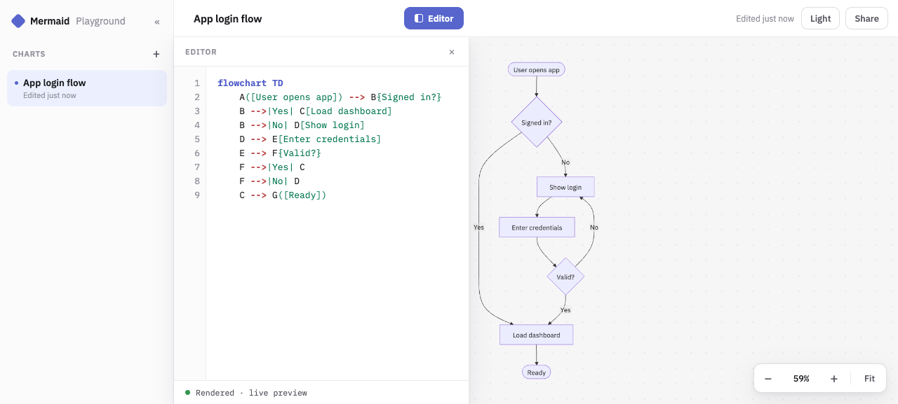

# Mermaid Playground

A fast, client-side [Mermaid](https://mermaid.js.org) diagram editor with live preview and zero-backend link sharing. Built with Svelte 5 (runes), Vite, and TypeScript. Deployed as static assets on Cloudflare Workers.

**Live: https://mermaid-playground.rgnsfyd7dm.workers.dev**

<picture>
  <source media="(prefers-color-scheme: dark)" srcset="docs/screenshot-dark.png">
  
</picture>

## Features

- **Live preview** - diagrams re-render as you type; parse errors show a toast while the last good diagram stays on the canvas
- **Multiple charts** - sidebar with add / select / rename / delete, persisted to localStorage
- **Editor** - Mermaid syntax highlighting, line-number gutter, render status bar
- **Pan & zoom canvas** - drag to pan, wheel to zoom toward the cursor, zoombar with percent reset and fit-to-screen
- **Light / dark theme** - one click, persisted, Mermaid re-themes together with the UI
- **Share by link, no server** - the whole chart travels inside the URL fragment

## Quick start

```
pnpm install
pnpm dev
```

## Commands

```
pnpm dev        # start the dev server
pnpm test       # unit tests (Vitest)
pnpm check      # svelte-check
pnpm build      # production build to dist/
pnpm preview    # serve the production build locally
pnpm e2e        # Playwright end-to-end suite
pnpm deploy:cf  # build and deploy to Cloudflare Workers
```

The e2e suite needs a one-time browser install:

```
pnpm exec playwright install chromium
```

## How sharing works

Clicking **Share** copies a link whose fragment carries the entire chart - nothing is uploaded anywhere:

```
#code: + base64url( deflate-raw( '{"n": <name>, "c": <code>}' ) )
```

Compression uses the browser-native `CompressionStream` API, so there are no extra dependencies. A ~4 KB diagram source becomes a URL of roughly 1.9K characters. Opening the link imports the chart into your local list (deduplicated by content) and cleans the hash; a corrupted link shows a `Broken share link` toast and the app continues normally. The link is transport - your localStorage stays the source of truth.

## Architecture notes

- Pure client-side SPA: no backend, no router, no SSR
- State is a single Svelte 5 `$state` singleton; Mermaid SVG injection, pan/zoom transforms, and editor scroll-sync are deliberately imperative islands behind `bind:this` + `$effect`
- Mermaid is dynamically imported into its own chunk, so the UI never waits for it; diagrams render with `securityLevel: 'strict'` because shared links can come from anyone
- `design-preview/` holds the original vanilla HTML/CSS/JS design reference the app is built against; `src/lib/tokens.test.ts` (color parity in oklch) and `e2e/parity.spec.ts` (structural sizes, themes) guard the fidelity
- CSS uses design tokens in oklch with `light-dark()`, `@layer`, and logical properties; `scripts/css-gate.sh` enforces the ruleset mechanically

## Deploy

The app deploys to Cloudflare Workers static assets (`wrangler.jsonc` is a config-only Worker serving `dist/`).

Local deploy from your machine:

```
pnpm deploy:cf
```

Autodeploy via Cloudflare Workers Builds: connect the repo in the Cloudflare dashboard with build command `pnpm build` and deploy command `npx wrangler deploy`. Push-to-main triggers a production deploy; other branches get preview deploys.

## License

[MIT](LICENSE)
